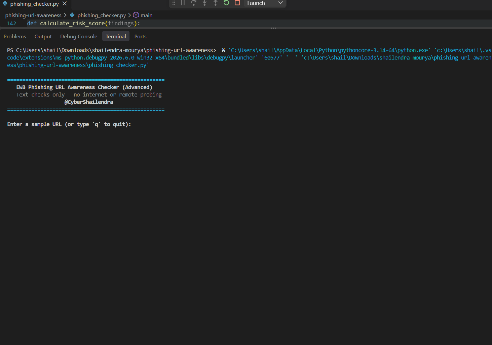

# EWB Phishing URL Awareness Checker

Author: Shailendra Mourya (CyberShailendra) | cybershailendra1@gmail.com

## Overview
Phishing is a deceptive attack where cyber criminals trick users with forged links or messages into surrendering passwords, credit card credentials, or OTPs. This tool inspects visible URL text patterns for structural and heuristic red flags completely offline. It **never** resolves, probes, or visits the target link.

## Features
### Core Workbook Detection Rules (100% Compliant):
- **@ Symbol Detection**: Flags credentials masquerading (`user@domain.com`).
- **Unusually Long URLs**: Flags strings exceeding 100 characters.
- **Direct IP Address Hostnames**: Flags bare IPv4 addresses using regular expressions.
- **Excessive Subdomain Segmentation**: Flags 5 or more hostname components.
- **Punycode (IDN) Indicators**: Flags `xn--` markers used in homograph impersonation.
- **Insecure HTTP Scheme**: Flags unencrypted transport.

### Advanced Heuristic Engine (New):
- **Risk Scoring (0–100) & Severity Rating**: Classifies threats into `LOW`, `MEDIUM / SUSPICIOUS`, and `HIGH / CRITICAL` based on cumulative weighted risk factors.
- **URL Shortener Detection**: Identifies services like `bit.ly`, `tinyurl.com`, `t.co`, etc., which mask destination targets.
- **High-Risk TLD Detection**: Highlights top-level domains commonly abused in disposable phishing campaigns (`.tk`, `.ml`, `.xyz`, `.top`, etc.).
- **Excessive Hyphen Domain Stacking**: Identifies domain spoofing tactics (e.g. `paypal-security-update-center.com`).
- **Contextual Security "Why" Insights**: Explains the exact vulnerability behind each flagged pattern.
- **Interactive Terminal UI**: Cyber-terminal formatting with ANSI colour coding and graceful session exit (`q`).
- **Safe Error Recovery**: Resilient parsing preventing crashes on invalid input (`http://[bad`).

## Requirements
Python 3.10 or later. Built entirely on Python standard libraries (`re`, `urllib.parse`). Zero external pip dependencies required.

## How to Run
Windows: `python phishing_checker.py`  
Mac/Linux: `python3 phishing_checker.py`

## Example Output
```text
====================================================
   EWB Phishing URL Awareness Checker (Advanced)    
   Text checks only - no internet or remote probing 
====================================================

Enter a sample URL (or type 'q' to quit): http://192.0.2.10/account

Result:
  ⚠ Uses an IP address instead of a familiar domain.
    Why: Honest services normally use readable names, not numbers.
  ⚠ Uses HTTP. HTTPS alone does not prove trust.
    Why: HTTP is not encrypted, so data can be seen on the way.

[REVIEW CAREFULLY: 2 warning sign(s) found | Risk Score: 45/100 (MEDIUM / SUSPICIOUS)]
Never enter passwords or personal data from unexpected links.
```

## Testing Evidence (Core 5 Tests)
| # | Input | Expected | Actual | Result |
|---|-------|----------|--------|--------|
| 1 | https://www.example.com/login | No warning signs | No listed warning signs found | PASS |
| 2 | http://192.0.2.10/account | IP address + HTTP | IP address + HTTP + Keyword (account) [Risk: 65/100 - HIGH] | PASS |
| 3 | http://example.com@sample.invalid/login | @ symbol + HTTP | @ symbol + HTTP + Keyword (login) [Risk: 60/100 - HIGH] | PASS |
| 4 | https://a.b.c.d.e.example.invalid/path | Many hostname segments | Many hostname segments [Risk: 20/100 - LOW] | PASS |
| 5 | https://xn--example.invalid/ | Punycode-style hostname | Punycode-style hostname [Risk: 25/100 - LOW] | PASS |

Full test evidence and bonus checks documented in [`tests/test_samples.md`](tests/test_samples.md).

## Screenshots

### 🖥️ Program Execution Preview (`sample_run.png`)


### 🧪 Test Evidence & Results Preview (`test_results.png`)


## Step-by-Step Implementation (How Each Task Was Done)

Following the EWB Cybersecurity Mini Project Workbook guide:

1. **URL Normalization (Stages 05 & 07)**:
   - Uses `.strip()` to prevent whitespace manipulation.
   - Automatically prefixes `http://` when schemes are missing so `urllib.parse.urlparse` can accurately extract authorities and paths.
   - Converts hostnames to lowercase for accurate parsing.

2. **Core 6 Detection Rules (Section 06 & 08)**:
   - **`@` Check**: Scans for user-info authority tricks.
   - **Length Check**: Inspects for URLs > 100 characters designed to hide origins.
   - **Regex IPv4 Check**: Validates bare IPs via `re.fullmatch(r"(?:\d{1,3}\.){3}\d{1,3}", host)`.
   - **Subdomain Counting**: Counts dot-separated components ($\ge 5$).
   - **Punycode**: Catches `xn--` internationalized spoofing.
   - **Scheme Check**: Alerts when unencrypted HTTP is utilized.

3. **Defensive Error Handling (Improvement C)**:
   - Traps malformed URI formats (like `http://[bad`) in a `try...except ValueError` block.

4. **Improvements & Advanced Additions (Section 10)**:
   - **Improvement A**: REPL session loop allowing continuous checks without restart.
   - **Improvement B**: Warning summary filter separating clean confirmations from actual risks.
   - **Improvement C**: Malformed input crash prevention.
   - **Improvement D**: Descriptive `REASONS` explanations for every trigger.
   - **Advanced Scoring**: Added weighted heuristic scoring engine outputting 0–100 risk values.
   - **Advanced Threat Detection**: Added URL shortener detection and high-risk TLD checks.

## Limitations
This is an educational defensive tool that operates strictly on URL text syntax. It does not ping servers, fetch page contents, inspect SSL certificates, or consult real-time reputation blocklists. **"No listed warning signs found" NEVER guarantees a link is safe.**

## Ethical Use
Operate exclusively on sample testing strings. Never test URLs without permission, never construct deceptive lures, and never collect credentials.

## Author
Shailendra Mourya (CyberShailendra), Cybersecurity Internship, EWB Courses  
Contact: cybershailendra1@gmail.com
