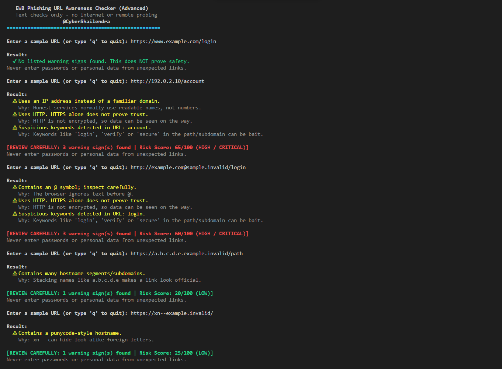

# Test Results

Author: Shailendra Mourya (CyberShailendra) | cybershailendra1@gmail.com

Python version used: 3.12 | Operating system: Windows 11 | Date: 2026-10-27

| # | Input | Expected result | Actual result | Pass/Fail |
|---|-------|-----------------|---------------|-----------|
| 1 | https://www.example.com/login | No listed warning signs | No listed warning signs found. This does NOT prove safety. | PASS |
| 2 | http://192.0.2.10/account | IP address + HTTP | Uses an IP address; Uses HTTP; Suspicious keyword (account) [Risk Score: 65/100 (HIGH / CRITICAL)] | PASS |
| 3 | http://example.com@sample.invalid/login | @ symbol + HTTP | Contains an @ symbol; Uses HTTP; Suspicious keyword (login) [Risk Score: 60/100 (HIGH / CRITICAL)] | PASS |
| 4 | https://a.b.c.d.e.example.invalid/path | Many hostname segments | Contains many hostname segments/subdomains. [Risk Score: 20/100 (LOW)] | PASS |
| 5 | https://xn--example.invalid/ | Punycode-style hostname | Contains a punycode-style hostname. [Risk Score: 25/100 (LOW)] | PASS |

## Advanced Heuristic Checks

| Input | Actual result | Pass/Fail |
|-------|---------------|-----------|
| (just Enter) | No URL entered. | PASS |
| www.example.com | Uses HTTP. HTTPS alone does not prove trust. | PASS |
| https://secure-login.example.invalid | No listed warning signs found. (Demonstrates why clean != safe) | PASS |
| http://[bad | This text is not a valid URL format. (No crash) | PASS |
| https://bit.ly/3xSample | Uses a known URL shortener service (destination is masked). | PASS |
| http://account-update.tk | Uses a high-risk TLD (.tk) + Uses HTTP. [Risk Score: 35/100] | PASS |

## Test Evidence Screenshot

## Notes
- Testing demonstrated that local heuristic syntax analysis can expose concealed threats (like Punycode homographs, bare IP links, and credential tricks) without sending any web traffic.
- Handling edge cases such as malformed IPv6 brackets (`http://[bad`) proved critical in making the program robust and crash-proof.
- Adding risk scores (0–100) and threat explanations makes the tool significantly more educational and intuitive for end users compared to raw text flags alone.

Shailendra Mourya | cybershailendra1@gmail.com
